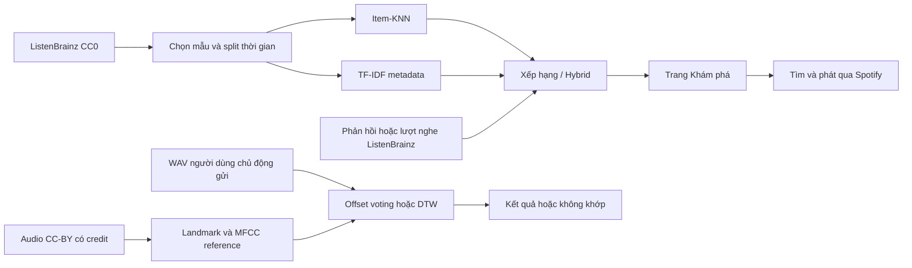

# Nghiên cứu và thực nghiệm thuật toán gợi ý, nhận diện âm nhạc

**Dự án:** Music Discovery Vietnam. **Ngày cập nhật:** 19/11/2026.

**Điều chỉnh giao diện 20/11/2026:** bỏ yêu cầu nhập tên người dùng ListenBrainz; luồng sử dụng chính chỉ cần sở thích và phản hồi trong web. Dataset huấn luyện và các thuật toán/số đo bên dưới không thay đổi. API hồ sơ công khai còn trong backend phục vụ nghiên cứu, không còn ô nhập trên trang Khám phá.

**Cập nhật 21/11/2026.** Trang Khám phá dùng Hybrid và tra thêm bài sau lượt Thích. Trang Nhận diện có chế độ so sánh hai thuật toán trên cùng bản ghi. Các bảng bên dưới dùng kết quả của cấu hình hiện tại, với phép thử mở rộng ứng viên ở mục 4.4.

Bản báo cáo kỹ thuật bám theo source và kết quả thực nghiệm kèm dự án. Thông tin sinh viên, giảng viên, trường, tên đề tài chính thức và quy định trình bày cần điền theo hồ sơ của sinh viên; không tự suy đoán.

## Tóm tắt

Đồ án xây dựng website khám phá âm nhạc, tìm/phát bài qua tích hợp Spotify và nhận diện bài từ đoạn âm thanh. Hai bài toán nghiên cứu được tách biệt: recommendation dùng quan hệ người–bài và metadata độc lập; identification dùng đặc trưng của bản ghi âm. Phần gợi ý so sánh Content-based TF-IDF/cosine với Item-based Collaborative Filtering, bổ sung Hybrid và Popularity baseline. Phần nhận diện so sánh spectral landmark/offset voting với MFCC/subsequence DTW. Dữ liệu được ghi nguồn, hai nhóm thuật toán được đo bằng quy trình cố định và lưu kết quả máy đọc. AudD/AcoustID chỉ là dịch vụ mở rộng, không được coi là thuật toán tự phát triển.

Trên mẫu 2.000 bài ListenBrainz, Recall@10 của Content-based, Collaborative và Hybrid lần lượt là 0,127437, 0,145172 và 0,147921. Bộ thử nhận diện có 10 bài tham chiếu và 176 đoạn thử cho mỗi thuật toán. Top-1 đạt 89,77% với Landmark và 55,68% với MFCC-DTW. Số liệu phản ánh mẫu ListenBrainz đã lọc và phép thử nhận diện với biến đổi số trên nhạc mở.

## 1. Bài toán, mục tiêu và phạm vi

### 1.1. Gợi ý âm nhạc

Đầu vào gồm các bài người dùng chủ động Thích/Lưu, phản hồi Không thích/Bỏ qua, sở thích và tùy chọn lượt nghe công khai ListenBrainz. Đầu ra là danh sách top-K bài chưa dùng làm cơ sở, tuân thủ bộ lọc và danh sách nghệ sĩ bị chặn. Mục tiêu là xếp bài có khả năng phù hợp cao hơn, không phải nhận diện tên bài từ âm thanh.

Người dùng mới chưa có hồ sơ được gợi ý theo độ phổ biến trong mẫu độc lập. Nếu bộ lọc không có dữ liệu hỗ trợ, giao diện thông báo thiếu kết quả, không tạo bài giả. Khi người dùng phản hồi, hồ sơ suy luận thay đổi ngay; không chạy lại huấn luyện toàn bộ sau mỗi lần bấm.

### 1.2. Nhận diện bài hát

Đầu vào là WAV 5–15 giây. Đầu ra là bản ghi khớp trong kho tham chiếu hoặc trạng thái chưa tìm thấy. Mỗi bản live, remix và cover có thể cho fingerprint riêng. Kho nội bộ gồm 10 bản nhạc mở, lập chỉ mục tối đa 120 giây đầu mỗi bản.

### 1.3. Nguồn nhạc và dữ liệu

- Spotify chỉ phục vụ tìm kiếm, metadata để hiển thị và phát bằng tích hợp hiện có. Không trích xuất audio Spotify để lập chỉ mục hoặc làm dữ liệu huấn luyện. Chính sách hiện hành có hạn chế việc phân tích/đưa Spotify Content vào mô hình [1].
- ListenBrainz cung cấp dữ liệu lượt nghe công khai CC0 [2]. Pipeline chỉ nhập metadata cần thiết, bỏ bản ghi xác định có nguồn Spotify và không nhập ID dịch vụ/tags cộng đồng.
- Bộ audio thử nghiệm dùng 8 file mà Wikimedia Commons ghi giấy phép CC BY 3.0, tác giả Kevin MacLeod. Nguồn và credit từng file nằm trong `backend/artifacts/recognition_sources.json`; xem thêm Phụ lục A. Audio thô nằm ngoài Git. Đây không phải tuyên bố quyền sử dụng với nhạc bất kỳ khác.

## 2. Cơ sở lý thuyết

### 2.1. Các hướng recommendation system

| Hướng | Nguyên lý | Ưu điểm / hạn chế | Trạng thái đồ án |
|---|---|---|---|
| Content-based | Tạo vector nội dung bài; so với hồ sơ từ bài đã thích | Không cần nhiều người nghe; phụ thuộc metadata và dễ lặp nghệ sĩ | Đã cài TF-IDF/cosine |
| User-based CF | Tìm người dùng có vector tương tác gần nhau; tổng hợp bài họ nghe | Khai thác gu cộng đồng; khó với người mới và nhiều người dùng | Phần tổng quan; chưa cài nhánh phục vụ |
| Item-based CF | Học độ giống giữa các cột bài trong ma trận người–bài | Dễ lập chỉ mục hàng xóm; khó với bài chưa có tương tác | Đã cài Item-KNN, tham khảo [3] |
| Hybrid | Kết hợp điểm CF và nội dung | Bổ sung tín hiệu; cần đánh giá trọng số, không đảm bảo luôn tốt hơn | Đã cài trọng số cố định 70/30 |
| Model-based / AI | Học biểu diễn ẩn bằng MF/ALS hoặc mô hình nơ-ron | Có thể mô hình hóa quan hệ phức tạp; cần dữ liệu/tài nguyên, kiểm soát overfit | Tổng quan ALS [4]; chưa cài neural/MF |

Không đồng nhất “AI” với việc gọi API hoặc bắt buộc mọi phương pháp phải có vòng lặp neural training. TF-IDF học thống kê corpus; Item-KNN học quan hệ từ tương tác; MFCC/DTW là xử lý tín hiệu và căn chỉnh chuỗi, không phải mạng nơ-ron đã huấn luyện.

### 2.2. Content-based TF-IDF/cosine

Mỗi bài được biểu diễn bằng token có cấu trúc: nghệ sĩ, nghệ sĩ+album, các nhãn genre/mood/tag và ngôn ngữ nếu có. Không sử dụng track ID làm đặc trưng; album được gắn với nghệ sĩ để tránh album cùng tên của hai nghệ sĩ bị đồng nhất.

Với N bài, `idf(t) = log((1+N)/(1+df(t))) + 1`; TF là nhị phân. Chuẩn hóa vector theo L2, sau đó tính cosine và giữ tối đa 50 hàng xóm/bài. Hồ sơ là tổng trọng số các bài đã thích/nghe, điểm ứng viên là tổng độ giống với các bài cơ sở. Nguồn hiện thiếu genre/mood/ngôn ngữ ở phần lớn bài, vì vậy baseline chủ yếu sử dụng nghệ sĩ và album; không thể gọi đây là hiểu nội dung audio hay ngữ nghĩa toàn diện.

### 2.3. Item-based Collaborative Filtering

Ma trận R có hàng là người nghe và cột là bài hát; `R[u,i] = log(1+play_count[u,i])`. Chuẩn hóa từng cột rồi tính cosine giữa bài i và j. Để hạn chế trùng hợp từ ít người, cần ít nhất 2 người cùng nghe và nhân hệ số `shared_users/(shared_users+10)`. Loại đường chéo và giữ top-50 hàng xóm. Khi suy luận, điểm ứng viên là tổng `profile_weight[i] * similarity[i,j]`.

Profile dùng `log(1+count)` cho ListenBrainz, giới hạn độ lớn; phản hồi Thích/Lưu có trọng số riêng. Phản hồi âm loại bài khỏi danh sách. Chỉ dùng hồ sơ của tài khoản đăng nhập; không đọc bảng lịch sử Spotify để huấn luyện/xếp hạng.

### 2.4. Hybrid

Chuẩn hóa từng tập điểm bằng giá trị lớn nhất rồi tính `0,7 * CF + 0,3 * Content`. Trọng số được cố định trước phép đo hiện tại, không tối ưu bằng nhãn test. Sau xếp hạng, bỏ bài đã làm cơ sở và áp dụng giới hạn số bài/nghệ sĩ theo mức đa dạng. Điểm trên giao diện là điểm xếp hạng tương đối, không phải xác suất.

### 2.5. Spectral landmark kiểu Shazam

Ý tưởng nền tảng tham khảo công trình của Avery Wang [5]: chọn các đỉnh phổ ổn định, ghép cặp theo thời gian, băm thành fingerprint; khi tra cứu, các hash trùng phải thống nhất độ lệch thời gian. Source đồ án là một hiện thực riêng theo ý tưởng này, không phải source Shazam hoặc bảo đảm tương thích hệ thống Shazam thương mại.

Cấu hình hiện dùng mono PCM16 11.025 Hz, STFT cửa sổ 2.048 và hop 512, với tối đa 4 đỉnh mỗi frame trong khoảng 260–3.500 Hz. Cặp landmark mã hóa hai dải tần và khoảng cách frame. BLAKE2s 64-bit tạo hash. Truy vấn dùng tối đa 700 hash phân bố theo đoạn thu. Offset voting dùng bucket 125 ms và đếm hash phân biệt. Bộ thử dùng tối thiểu 12 phiếu và ngưỡng chọn từ tập hiệu chỉnh.

### 2.6. MFCC + subsequence DTW

MFCC mô tả đường bao phổ, còn DTW tìm đường căn chỉnh giữa đoạn query và một chuỗi dài hơn. Hướng sử dụng MFCC và subsequence alignment có tiền lệ trong nghiên cứu đối chiếu âm nhạc [6]; cấu hình đồ án là baseline đơn giản, không tái hiện đầy đủ hệ thống trong bài báo.

Cấu hình: FFT 1.024, hop 512, 40 bộ lọc mel từ 80–5.000 Hz, log năng lượng, DCT-II lấy C1–C13 và bỏ C0 để giảm ảnh hưởng gain. Chuẩn hóa vector từng frame. Chi phí cục bộ là `1-cosine`. DTW cho phép bắt đầu ở vị trí bất kỳ của reference, dùng bước (1,1), (1,2), (2,1), cộng chi phí theo tiến độ query rồi chia số frame query. Điểm khớp hiển thị là `1-average_cost`, giới hạn 0..1. Bài có chi phí nhỏ nhất phải vượt ngưỡng calibration mới được chấp nhận.

## 3. Thiết kế hệ thống và hiện thực

| Thành phần | Tệp chính |
|---|---|
| TF-IDF/cosine | `backend/app/services/content_recommendation.py` |
| CF/Hybrid và áp dụng hồ sơ | `backend/app/services/collaborative.py` |
| Chia dữ liệu, huấn luyện, so sánh gợi ý | `backend/tools/train_recommender.py` |
| Landmark/hash/voting | `backend/app/services/landmark_fingerprint.py` |
| MFCC/DTW | `backend/app/services/mfcc_dtw.py` |
| Hai bộ nhận diện nội bộ | `backend/app/services/local_recognition.py` |
| Chuẩn bị nhạc mở và benchmark | `backend/tools/prepare_open_audio.py`, `evaluate_recognition.py` |
| API | `backend/app/routers/recommendations.py`, `identify.py` |
| UI lựa chọn phương pháp | `frontend/src/components/discovery-panel.tsx`, `frontend/src/app/identify/page.tsx` |

API gợi ý nhận `method=item_knn/content_based/hybrid`. API nội bộ nhận diện là `POST /api/identify/local?method=landmark/mfcc_dtw`; phải đăng nhập, chỉ nhận WAV ngắn, giới hạn dung lượng, xử lý trong thư mục tạm rồi xóa. Không gọi AudD/Spotify từ nhánh nội bộ, không tự lưu bản thu vào kho tham chiếu. Ngưỡng và metadata reference lấy từ artifact được tạo bởi lệnh đánh giá. Trình đọc NPZ dùng `allow_pickle=False`.

## 4. Thực nghiệm gợi ý

### 4.1. Dữ liệu và quy trình

Nguồn incremental dump ListenBrainz 13/11/2026, checksum SHA256 xác minh với máy chủ. Quét 6.177.546 dòng, lấy lượt nghe từ 13/10/2026, loại các bản ghi nhận biết có nguồn Spotify. Chọn vocabulary bằng độ hỗ trợ **trong train**, tối thiểu 3 người nghe/bài, giữ 2.000 bài. Người nghe cần ít nhất 5 bài trong phần train. Metadata nội dung giữ lần xuất hiện sớm nhất, tránh dùng nhãn album từ tương lai.

Mẫu cuối: **167.468 lượt nghe, 3.283 người, 2.000 bài**. Split toàn cục tại **12/11/2026 17:30:40 UTC**: train 144.628 lượt, test 22.840 lượt. Có 1.154 người đủ điều kiện đánh giá bài mới. Các phương pháp dùng cùng vocabulary, cùng tập người/test target, không lấy tập negative nhỏ ngẫu nhiên để làm đẹp kết quả. Sau khi đo, artifact phục vụ CF được refit trên toàn bộ mẫu; số đo công bố là từ mô hình chỉ học train.

### 4.2. Chỉ số

- Precision@10 = số bài đúng trong 10 đề xuất / 10; nếu trả ít hơn 10 vẫn dùng mẫu số 10.
- Recall@10 = số bài đúng / số bài test mới của người đó.
- NDCG@10 xét vị trí của bài đúng, chia DCG lý tưởng.
- Hit rate@10 là tỷ lệ người có ít nhất một bài đúng.
- Coverage là phần vocabulary xuất hiện ít nhất một lần trong các đề xuất.

Lấy trung bình theo người, không theo số lượt nghe để người nghe nhiều không chi phối toàn bộ phép đo.

### 4.3. Kết quả

| Phương pháp | Precision@10 | Recall@10 | NDCG@10 | Hit rate@10 | Coverage |
|---|---:|---:|---:|---:|---:|
| Popularity | 0,011438 | 0,016371 | 0,019857 | 0,045927 | 0,019500 |
| Content-based | 0,045407 | 0,127437 | 0,101629 | 0,225303 | 0,675500 |
| Item-KNN CF | 0,055546 | 0,145172 | 0,118809 | 0,282496 | 0,689000 |
| Hybrid 70/30 | 0,054766 | 0,147921 | 0,119228 | 0,279029 | 0,711000 |

Item-KNN đạt Precision@10 và Hit rate@10 cao nhất trong mẫu này. Hybrid đạt Recall@10, NDCG@10 và độ phủ cao nhất. Khi người dùng bấm **Thích**, trang Khám phá tra tối đa hai nghệ sĩ ghi công trên bài hoặc nghệ sĩ đang thiếu trong kho. Hybrid xếp hạng các bài tìm được cùng kho hiện có. Bài mới có thể nhận điểm Content-based ngay từ metadata. Trang hiển thị số ứng viên mới và số bài mới lọt vào top 10 khi tra cứu có kết quả.

Đây là mẫu đã lọc bài phổ biến và người có dữ liệu, không đại diện cho cold-start hay long-tail toàn bộ hệ thống. Giá trị vocabulary coverage 1,0 trong báo cáo JSON là do phép đo giới hạn trên tập đã chọn, không chứng minh phủ toàn bộ âm nhạc.

### 4.4. Mở rộng tập ứng viên bằng metadata

Trên cùng 1.154 người dùng và cùng mốc thời gian, chọn cố định 395 trong 2.000 mã bài bằng hàm băm. Cả hai lượt thử dùng cùng hồ sơ nghe từ 1.605 bài ban đầu, cùng quy tắc loại bài đã nghe và cùng đích kiểm thử. Lượt thứ hai đưa 395 bài trở lại dưới dạng ứng viên chỉ có metadata. Hai lượt dùng cùng đồ thị Collaborative đã xây từ 1.605 bài.

| Chỉ số Hybrid | Kho ban đầu | Bổ sung ứng viên chỉ có metadata |
|---|---:|---:|
| Tỷ lệ bài đích có mặt trong tập ứng viên | 80,55% | 100% |
| Recall@10 | 12,39% | 13,29% |
| NDCG@10 | 0,1026 | 0,1066 |
| Số bài chỉ có metadata trong top 10, trung bình mỗi người | 0 | 0,174 |

Lượt thử giả định đã lấy được metadata của toàn bộ 395 bài. Chỉ số này đo tác động của việc thêm ứng viên trên bộ dữ liệu cố định. Tỷ lệ tra thành công và độ trễ của MusicBrainz nằm ngoài phép thử. Có thể tái tạo bằng `--evaluate-catalog-expansion` của `tools.train_recommender`.

## 5. Thực nghiệm nhận diện

### 5.1. Dữ liệu và chống dùng test để chỉnh ngưỡng

Tập dữ liệu có 13 bản ghi từ Wikimedia Commons, gồm 10 bản tham chiếu, một bản ngoài kho để hiệu chỉnh và hai bản ngoài kho để kiểm thử. Mỗi bản tham chiếu được lập chỉ mục tối đa 120 giây đầu, hoặc toàn bộ bản ghi nếu ngắn hơn. Đoạn thử dài 8 giây. Đoạn hiệu chỉnh bắt đầu ở 3,137 giây. Các đoạn kiểm thử bắt đầu ở 20,319 và 30,173 giây, cùng tối đa hai đoạn sau giây 60 khi bản ghi đủ dài.

Tập hiệu chỉnh gồm đoạn sạch và nhiễu 10 dB, 0 dB. Chọn ngưỡng tối đa hóa trung bình tỷ lệ nhận đúng bài trong kho và tỷ lệ từ chối đúng bài ngoài kho. Hai ngưỡng lần lượt là **0,069286** cho Landmark với tối thiểu 12 phiếu và **0,911317** cho MFCC-DTW.

Test gồm 4 điều kiện: sạch, gain 0,3, nhiễu Gaussian SNR 10 dB và SNR 0 dB. Seed 20261119 cố định và hai thuật toán xử lý cùng tệp. Mỗi phương pháp được thử trên **176 đoạn**, gồm 144 đoạn trong kho và 32 đoạn ngoài kho. Đây là bộ dữ liệu biến đổi số trên nhạc thật. Chế độ so sánh trên `/identify` dùng cùng bản ghi qua micro hoặc WAV và hiển thị kết quả từng thuật toán cùng thời gian xử lý.

### 5.2. Chỉ số và kết quả

Top-1 tính số đoạn đúng tên hoặc được từ chối đúng. Known recall đo tỷ lệ đúng tên trên các đoạn trong kho. Precision đo tỷ lệ đúng tên trên kết quả được chấp nhận. FAR đo tỷ lệ đoạn ngoài kho bị nhận nhầm thành bài trong kho. Thời gian dưới đây gồm trích đặc trưng và đối chiếu với chỉ mục đã nạp.

| Phương pháp | Top-1 accuracy | Known recall | Precision | Unknown FAR | p50 / p95 (ms) |
|---|---:|---:|---:|---:|---:|
| Landmark | 0,897727 (158/176) | 0,944444 (136/144) | 0,931507 | 10/32 | 82,747 / 199,808 |
| MFCC-DTW | 0,556818 (98/176) | 0,527778 (76/144) | 0,883721 | 10/32 | 94,623 / 133,789 |

| Điều kiện | Landmark Top-1 | MFCC-DTW Top-1 |
|---|---:|---:|
| Sạch | 0,931818 | 0,886364 |
| Gain 0,3 | 0,931818 | 0,886364 |
| Nhiễu 10 dB | 0,886364 | 0,272727 |
| Nhiễu 0 dB | 0,840909 | 0,181818 |

Trong 64 đoạn thuộc bài trong kho bắt đầu sau giây 60, Landmark nhận đúng 61 đoạn và MFCC-DTW nhận đúng 32 đoạn. Cả hai nhận nhầm 10/32 đoạn ngoài kho. Các đoạn này chỉ đến từ hai bản ghi nên kết quả dùng để mô tả bộ thử hiện tại. Kho lớn hơn cần thêm bản ngoài kho đa dạng để đánh giá ngưỡng. Đo micro thực tế bằng chế độ so sánh hoặc `tools.evaluate_microphone` với bản ghi có nhãn.

## 6. Hạn chế, đánh giá và hướng phát triển

1. Thu micro thực tế: thiết kế tập riêng, giữ nhãn/đoạn gốc, khoảng cách loa, tiếng nói, độ vang và mức ồn; không chỉnh ngưỡng trên chính tập test.
2. Mở rộng audio tham chiếu có quyền sử dụng; 2.000 dòng metadata của recommender không thể thay thế 2.000 bản audio.
3. Recommendation: bổ sung metadata độc lập và dữ liệu nhạc Việt, nghiên cứu User-based CF và ALS/NCF như các thí nghiệm tiếp theo, chưa gắn nhãn đã triển khai.
4. Đo cold-start, nhiều kích thước K, long-tail, độ đa dạng và khảo sát người dùng; lựa chọn hyperparameter bằng validation riêng.
5. Nhận diện: tối ưu inverted index landmark tái sử dụng giữa các request; bổ sung tempo/pitch shift, clipping và codec nén; nghiên cứu biểu diễn audio học máy nếu có bộ huấn luyện hợp lệ.
6. AudD có kho riêng và giới hạn riêng. Không có kết quả từ một đoạn thu không chứng minh bài không tồn tại trong kho của họ; không báo kết quả AudD là thuật toán tự cài đặt.

## 7. Kết luận

Bản hiện tại thực hiện và so sánh ít nhất hai thuật toán cho mỗi bài toán. Trang Khám phá dùng Hybrid mặc định, còn trang Nhận diện chạy cả hai thuật toán trên cùng đoạn âm thanh. Thử nghiệm cho thấy Landmark nhận đúng nhiều đoạn trong kho hơn trên bộ thử nhiễu số. Cần đánh giá thêm bản thu qua micro và độ phủ nhạc Việt.

## Tài liệu tham khảo

[1] Spotify. [Developer Policy](https://developer.spotify.com/policy), mục phân tích dữ liệu và ML/AI; kiểm tra 19/11/2026.

[2] MetaBrainz. [Dataset licenses](https://metabrainz.org/datasets/postgres-dumps); ListenBrainz [data dumps](https://listenbrainz.readthedocs.io/en/latest/users/listenbrainz-dumps.html).

[3] Sarwar, B. et al. (2001). [Item-Based Collaborative Filtering Recommendation Algorithms](https://files.grouplens.org/papers/www10_sarwar.pdf).

[4] Hu, Y., Koren, Y., Volinsky, C. (2008). [Collaborative Filtering for Implicit Feedback Datasets](https://ieeexplore.ieee.org/abstract/document/4781121/authors). Tài liệu tổng quan hướng MF/ALS, không phải thuật toán đang phục vụ trong đồ án.

[5] Wang, A. (2003). [An Industrial-Strength Audio Search Algorithm — ISMIR presentation](https://ismir2003.ismir.net/presentations/Wang.pdf).

[6] Kim, T., Choi, M., Sacks, E., Yang, Y.-H., Nam, J. (2020). [A Computational Analysis of Real-World DJ Mixes Using Mix-to-Track Subsequence Alignment](https://archives.ismir.net/ismir2020/paper/000352.pdf). ISMIR. Không đồng nhất baseline đồ án với toàn bộ hệ thống của tác giả.

[7] Kevin MacLeod. [Music licensing](https://incompetech.com/music/royalty-free/licenses/); giấy phép của từng file lấy từ trang Commons tương ứng, không áp một giấy phép chung cho mọi nhạc của tác giả.

## Phụ lục A — Ghi công nguồn audio

Các bản đầu dưới đây của **Kevin MacLeod** có giấy phép **[CC BY 3.0](https://creativecommons.org/licenses/by/3.0/)**. Bản xử lý dùng tối đa 120 giây đầu, trộn mono và lấy mẫu lại 11.025 Hz/PCM16 sau lọc chống alias. Danh sách đầy đủ kèm giấy phép từng bản được lưu trong [`recognition_sources.json`](../backend/artifacts/recognition_sources.json).

- [Tranquility](https://commons.wikimedia.org/wiki/File:Kevin_MacLeod_-_Tranquility.ogg)
- [Ritual](https://commons.wikimedia.org/wiki/File:Kevin_MacLeod_-_Ritual.ogg)
- [Broken Reality](https://commons.wikimedia.org/wiki/File:Kevin_MacLeod_-_Broken_Reality.ogg)
- [On the Passing of Time](https://commons.wikimedia.org/wiki/File:Kevin_MacLeod_-_On_the_Passing_of_Time.ogg)
- [Parisian](https://commons.wikimedia.org/wiki/File:Kevin_MacLeod_-_Parisian.ogg)
- [Thatched Villagers](https://commons.wikimedia.org/wiki/File:Kevin_MacLeod_-_Thatched_Villagers.ogg)
- [The Endless](https://commons.wikimedia.org/wiki/File:Kevin_MacLeod_-_The_Endless.ogg) — chỉ unknown calibration
- [Radio Martini](https://commons.wikimedia.org/wiki/File:Kevin_MacLeod_-_Radio_Martini.ogg) — chỉ unknown test

## Phụ lục B — Tái tạo và bằng chứng

Xem `DOI_CHIEU_YEU_CAU_GIANG_VIEN.md` để chạy lệnh. Số đo nguyên bản ở `backend/artifacts/evaluation.json`, `recognition_evaluation.json`, `recognition_evaluation.csv`; provenance ở `recognition_sources.json`. Kiểm thử logic/API tách khỏi số đo dataset. Dữ liệu thô ở `backend/data` được gitignore, model/feature phục vụ không chứa raw audio hoặc tên người nghe ListenBrainz.
